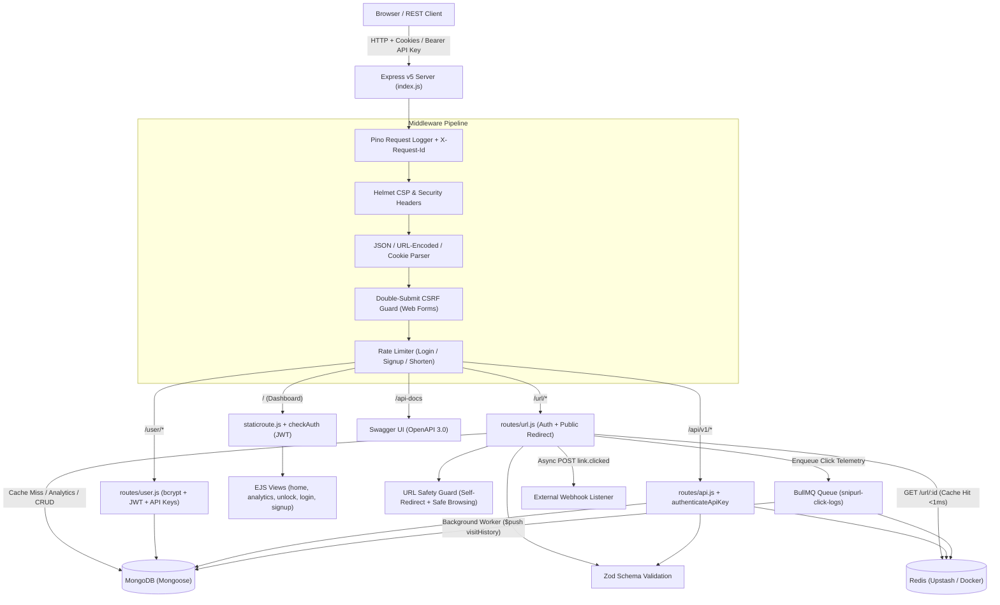

# ✂ SnipURL — Production-Grade URL Shortener

> A full-stack URL shortening platform built with **Node.js**, **Express v5**, **MongoDB**, **Redis / BullMQ**, and **EJS** — featuring JWT & bcrypt auth, CSRF protection, Zod validation, Pino structured logging, Redis caching, async click queueing, webhooks, QR codes, rich analytics, and a Swagger-documented REST API.

---

## 📸 Features at a Glance

| Feature | Details |
|---|---|
| 🔗 URL Shortening | Shorten any `http://` or `https://` URL with duplicate-per-user protection & PRG reload safety |
| 🏷️ Custom Aliases | Optional 3–30 character slugs (`/url/my-brand`) with uniqueness validation |
| ⏳ Date & Max-Click Expiry | Optional expiration date or max click limit per link — expired links return `410 Gone` |
| 🔒 Password-Protected Links | Optional bcrypt-hashed link password with `/url/:id/unlock` prompt |
| ✏️ Edit, Pause & Delete | Update destination/webhook (`POST /url/edit/:id`), pause/resume (`isActive`), or delete permanently |
| ⚡ Redis Caching + BullMQ | `ioredis` caches `shortId → redirectId` (0 DB `findOne` lookups on hit); BullMQ queues click logs asynchronously |
| 🤖 Bot Filtering | Separates human clicks from bots/crawlers (`Googlebot`, `curl`, `Slackbot`, `WhatsApp`, etc.) |
| 🔔 Click Webhooks | Optional `webhookUrl` fires non-blocking `POST` JSON (`X-SnipURL-Event: link.clicked`) on every click |
| 🛡️ URL Safety Guard | Blocks self-redirects, cloud metadata IPs (`169.254.169.254`), and optional Google Safe Browsing v4 check |
| 🏷️ Tags & UTM Builder | Organize links with `#tags` (`?tag=`) and auto-append `utm_source`, `utm_medium`, `utm_campaign` |
| 📱 QR Code & CSV Export | Dark-themed QR code PNG download, date-range filter (`24h`/`7d`/`30d`/`all`), formula-safe CSV export |
| 🔍 Search, Sort & Pagination | Filter links by alias/URL/tag (`?q=`, `?tag=`), sort (`newest`, `oldest`, `most_clicked`), paginate (`?page=`) |
| 🔑 REST API & Swagger Docs | Per-user SHA-256 API keys (`/api/v1/*`) + interactive OpenAPI 3.0 docs at `/api-docs` |
| 🔐 Security & Observability | `bcryptjs`, `httpOnly` JWT, `helmet`, `express-rate-limit`, double-submit CSRF, `zod`, `pino` + `X-Request-Id` |
| 🐳 Docker & Cloud Ready | `Dockerfile`, `docker-compose.yml`, `trust proxy`, `GET /health`, and Upstash `rediss://` TLS support |
| 🧪 Automated Tests | **138 tests** across 6 suites (`npm test`) |

---

## 🗂️ Project Structure

```
15_URL_Shortener_EJS_Authentication/
│
├── index.js                   # Entry point — Pino, Helmet CSP, CSRF, Swagger, routes, BullMQ, /health
├── connection.js              # MongoDB connection via Mongoose
├── package.json               # Scripts: start (nodemon), test (138 tests across 6 suites)
├── Dockerfile                 # Production container image
├── docker-compose.yml         # App + MongoDB + Redis stack
├── .env                       # Environment config (ignored by git)
│
├── models/
│   ├── url.js                 # URL Schema (shortId, redirectId, expiresAt, maxClicks, passwordHash, tags, webhookUrl, visitHistory)
│   └── user.js                # User Schema (name, email, hashed password, apiKeyHash, apiKeyPrefix)
│
├── validators/
│   └── schemas.js             # Zod validation schemas (signup, login, createUrl, editUrl)
│
├── controllers/
│   ├── url.js                 # Shorten, Redis-cached redirect, unlock, BullMQ enqueue, analytics, CSV export, edit, toggle, delete
│   └── user.js                # Signup (bcrypt), login (JWT httpOnly cookie), logout, API key generate/revoke
│
├── routes/
│   ├── staticroute.js         # GET / (search, tag, sort, pagination), /login, /signup
│   ├── url.js                 # POST /url, analytics, export, edit, toggle, delete, unlock, GET /url/:id
│   ├── user.js                # POST /user, /user/login, GET /user/logout, POST /user/api-key(/revoke)
│   └── api.js                 # REST API v1 (/api/v1/shorten, /links, /analytics/:id)
│
├── middlewares/
│   ├── auth.js                # restrictToLoggedInUserOnly, checkAuth (JWT token cookie)
│   ├── apiAuth.js             # authenticateApiKey (SHA-256 lookup from Bearer / x-api-key)
│   ├── csrf.js                # Double-submit cookie CSRF protection
│   ├── rateLimiter.js         # loginLimiter (10/15m), signupLimiter (5/hr), urlShortenLimiter (30/15m)
│   └── requestLogger.js       # Pino child logger + X-Request-Id header
│
├── service/
│   ├── auth.js                # Stateless JWT sign & verify
│   ├── cache.js               # Redis caching layer (ioredis)
│   ├── clickQueue.js          # BullMQ async click logging queue & worker (supports rediss:// TLS)
│   ├── logger.js              # Pino JSON logger
│   ├── swagger.js             # OpenAPI 3.0 specification
│   ├── urlSafety.js           # Self-redirect, metadata SSRF, & Google Safe Browsing checks
│   └── webhook.js             # Async POST JSON click webhook dispatcher
│
├── views/                     # EJS templates
│   ├── home.ejs               # Dashboard — shorten form, advanced options, search/tags/pagination, API key panel
│   ├── analytics.ejs          # Human vs bot stats, range filter, CSV export, edit destination/webhook, QR, Chart.js
│   ├── unlock.ejs             # Password prompt for protected short links
│   ├── login.ejs              # Login form
│   ├── signup.ejs             # Signup form
│   └── error.ejs              # Error page (400, 403, 404, 410, 500)
│
└── tests/
    ├── phase2.test.js         # 84 unit & schema tests
    ├── integration.test.js    # 14 HTTP integration tests
    ├── phase4.test.js         # 12 Redis cache hit/invalidation & REST API tests
    ├── phase5.test.js         # 12 Docker, Swagger, password/max-click, tags, UTM, CSV tests
    ├── phase6.test.js         # 6 webhook & URL safety guard tests
    └── phase7.test.js         # 10 BullMQ queue, Pino request ID, Zod, & CSRF tests
```

---

## 🏗️ Architecture Diagram



---

## ⚙️ Setup & Installation

### Option A: Local / Hosted Redis (Upstash)
```bash
git clone https://github.com/Hetshah573/SnipURL-URL-Shortener.git
cd SnipURL-URL-Shortener
npm install
```

Create a `.env` file in the project root:
```env
PORT=5000
MONGO_URI=mongodb://localhost:27017/short-url
JWT_SECRET=replace_with_a_long_random_secret_string
JWT_EXPIRES_IN=7d
REDIS_URL=rediss://default:<password>@<host>:<port>   # or redis://localhost:6379
# Optional:
# APP_HOST=yourdomain.com
# GOOGLE_SAFE_BROWSING_API_KEY=your_api_key
```

Run tests and start:
```bash
npm test
npm start
```

### Option B: Docker Compose (App + MongoDB + Redis)
```bash
docker compose up --build
```

Open `http://localhost:5000` (or `http://localhost:5000/api-docs` for Swagger UI).

---

## 🧪 Running Tests

```bash
npm test
```

Runs all **138 tests** across 6 suites (`phase2`, `integration`, `phase4`, `phase5`, `phase6`, `phase7`).

---

## 📄 License

This project is for educational purposes. Feel free to fork and extend it.
